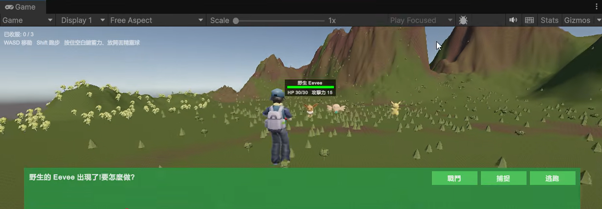
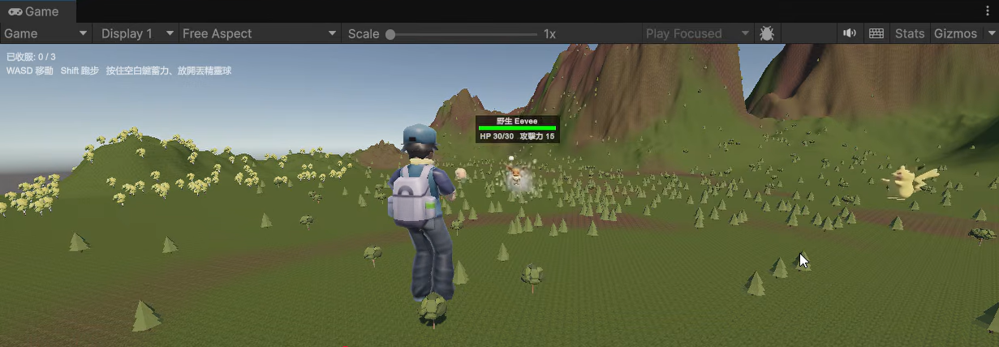
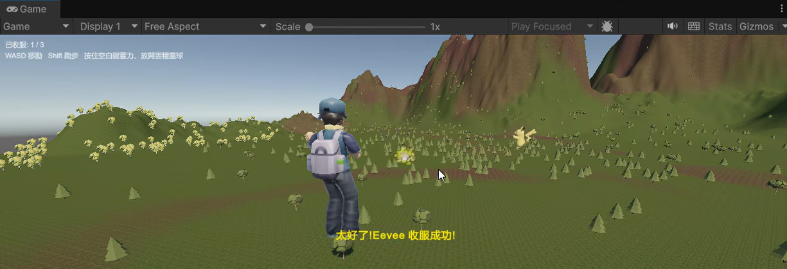

# 1151VR-HW5-414262351-DPT

YouTube : <https://youtu.be/xEjvCoGNLBY>

Github : <https://github.com/cheese91383/1151VR-HW5-414262351-DPT>

- 訓練家用 WASD／方向鍵移動，按住 Shift 跑步，走路時自動轉向，並有走路動作(腿、膝蓋、手臂擺動)。

- 皮卡丘、伊布、木木梟在草地上隨機跑動，貼著地形高低起伏。

- 訓練家走到寶可夢附近，寶可夢會跳一下、停下來看向訓練家，同時鏡頭切到訓練家背後，下方出現綠色選單:戰鬥、捕捉、逃跑。

- 捕捉:按住空白鍵蓄力(畫面有力道條與建議力道標記)，放開後訓練家播放丟球動畫，精靈球由左至右以拋物線飛出。

- 收服特效:閃光、寶可夢縮進球裡、球落地搖晃 3 次、冒出星星，顯示「收服成功」。

- 戰鬥:派出已收服的寶可夢，雙方自動輪流攻擊，顯示血量條、攻擊力與傷害數字。打贏可選擇收服或放走，打輸野生寶可夢會逃走，一段時間後回到原地。

- 有丟球與收服音效以及背景音樂。

# 操作方式

| **按鍵**                   | **功能**                     |
|----------------------------|------------------------------|
| W A S D／方向鍵            | 移動                         |
| Shift                      | 跑步                         |
| 按住空白鍵／滑鼠左鍵，放開 | 蓄力、丟出精靈球             |
| Esc                        | 取消丟球，回到選單           |
| 滑鼠點選單按鈕             | 戰鬥／捕捉／逃跑、收服／放走 |

# 製作流程

## 1. 建立專案與匯入素材

- Unity 6 建立 3D 專案。

- 匯入訓練家模型(Humanoid，加上 Animator 與自製 Throw 丟球動畫)、寶可夢模型(PikachuF、Eevee、Rowlet)、精靈球模型(Pokeball)。https://models.spriters-resource.com/

- 音效使用 Pixabay swoosh / success (<https://pixabay.com/sound-effects/search/swoosh/>) ( <https://pixabay.com/sound-effects/search/success/>)

- 背景音樂: Pixabay ([Funny Comedy Sneaky Music](https://pixabay.com/sound-effects/musical-funny-comedy-sneaky-music-620907/))

## 2. 場景

- 用 Terrain 建立地形，Raise or Lower Terrain 畫出背景有起伏的山，Paint Texture 鋪草地。

- Paint Trees 種樹、Paint Details 種草。

- 攝影機放在訓練家側面，寶可夢放在訓練家右側，丟球時從畫面左邊飛到右邊。

## 3. 處理訓練家手上的球

訓練家模型的手上原本黏了兩顆精靈球，它們是 Humanoid 骨頭(LPokeballN/M、RPokeballN/M)，不能用取消勾選隱藏。做法是把骨頭的 Scale 縮成 0:

- 左手那顆(LPokeballN、LPokeballM)在 Hide On Start 欄位，開始時縮成 0。

- 右手那顆保留，丟球時 Hand Ball(RPokeballN)與 More Hand Balls(RPokeballM)縮成 0，收服結束後恢復。

- 縮放放在 LateUpdate 執行，避免被動畫蓋回去。

## 4. 丟球動畫的製作流程

訓練家的丟球動作沒有現成素材，是自己用 Unity 的 Animation 視窗做出來的 Throw 動畫。製作流程如下：

- 選取 Hierarchy 裡的 Pokemon Trainer（Humanoid，身上有 Animator），打開 Window \> Animation \> Animation。按 Create 建立新的動畫檔，命名為 Throw，存到 Assets 資料夾。

- 按 Add Property，只加入會動到的 Humanoid 肌肉曲線：右手臂、前臂、脊椎、胸部。沒有用到的部位不要加，這樣不會影響身體其他部分，也避免播放時人物倒地。

- 動畫長度約 0.83 秒（60 FPS），在時間軸上設定關鍵影格：先把手臂往後拉、身體稍微後仰（蓄力），再把手臂往前甩、身體前傾（出手），最後回到原本的姿勢。

- 在 Animation 視窗按播放預覽，調整每個關鍵影格的數值，直到動作看起來自然為止。手往前甩的那一刻大約在 0.35 秒，這個時間之後會用來決定球離手的時間。

- 點選 Throw 動畫檔，在 Inspector 取消勾選 Loop Time，讓動畫只播放一次。

- 在 Pokemon Trainer 的 Animator 取消勾選 Apply Root Motion，避免動畫移動人物位置。

- PokeballThrow 腳本直接播放 Throw 動畫（Direct Control）：沒有丟球時，訓練家停在 Throw 的第一格當站姿，放開空白鍵才播放一次 Throw，播完再回到第一格。

- 球離手的時間用 Release Delay（0.35 秒）對齊手往前甩的瞬間：時間到時，手上的球縮成 0，同一個位置產生一顆會飛出去的精靈球。

## 5. 腳本

| **腳本**              | **掛在**             | **功能**                                                                                      |
|-----------------------|----------------------|-----------------------------------------------------------------------------------------------|
| TrainerController.cs  | TrainerRoot          | CharacterController 移動、依攝影機方向換算 WASD、轉向、重力，自動依模型身高設定碰撞範圍與速度 |
| TrainerWalkAnim.cs    | TrainerRoot          | 沒有走路動畫素材，用程式在 LateUpdate 轉動 Humanoid 的腿、膝蓋、手臂骨頭做出走路動作          |
| PokeballThrow.cs      | TrainerRoot          | 蓄力丟球、播放 Throw 動畫、計算拋物線初速度、手上的球縮放、HUD                                |
| PokeballProjectile.cs | (丟球時自動加到球上) | 判斷打中寶可夢或落地，執行收服流程與特效                                                      |
| EncounterManager.cs   | TrainerRoot          | 遇敵流程:背後鏡頭、OnGUI 綠色選單、自動對戰、打贏收服或放走、打輸逃走                         |
| PokemonWander.cs      | 每隻寶可夢           | 隨機移動、貼地、偵測訓練家靠近後停下、血量與攻擊力                                            |
| CameraFollow.cs       | Main Camera          | 從側面跟隨訓練家，高度平滑跟隨，遇敵時接受指定位置                                            |
| CaptureEffect.cs      |                      | 用程式建立 ParticleSystem 粒子特效                                                            |
| GameInput.cs          |                      | 同時支援舊版 Input Manager 與新版 Input System                                                |
| BackgroundMusic.cs    | 空物件 BGM           | 循環播放背景音樂                                                                              |

| **功能**       | **做法**                                                                                                                                                    |
|----------------|-------------------------------------------------------------------------------------------------------------------------------------------------------------|
| 訓練家移動     | CharacterController.Move，依攝影機方向換算 WASD，Quaternion.RotateTowards 轉向移動方向，每幀加上重力。                                                      |
| 丟球時機       | 放開空白鍵後先播放 Throw 動畫，等 Release Delay(0.35 秒)手往前甩時才產生精靈球。                                                                            |
| 蓄力與拋物線   | 精靈球加上 Rigidbody 受重力影響。依力道決定落點距離，算出飛行時間 t，初速度 = (目標 − 起點) / t − ½ × 重力 × t，球就會落在目標點。                          |
| 寶可夢亂跑     | 在出生點半徑內隨機挑目的地走過去，休息一下再挑下一個；高度差太大的點(山上)不去。                                                                            |
| 貼地           | Terrain 上用 Terrain.SampleHeight 取地面高度；不在 Terrain 上時用 Physics.RaycastAll 往下打射線。                                                           |
| 停下來讓玩家抓 | 每幀計算與訓練家的水平距離，小於 Stop Distance 時進入 Alert 狀態:停止移動、轉向訓練家、跳一下。                                                             |
| 背後鏡頭       | EncounterManager 算出訓練家與寶可夢的連線，把鏡頭放在訓練家後方偏右，看向兩者之間，讓訓練家在畫面左邊、寶可夢在右前方。                                     |
| 鎖定目標       | 遇敵時只允許收服被鎖定的那一隻，旁邊的寶可夢球會穿過，不會誤抓。                                                                                            |
| 對戰           | 雙方輪流攻擊，傷害 = 攻擊力 × 隨機 0.7~1.3;血量歸零者倒下。打贏可收服，打輸野生寶可夢逃走。                                                                 |
| 收服特效       | 球停在空中 → 白色閃光 → 寶可夢縮小飛進球裡 → 球落地 → 搖 3 下 → 星星粒子 → 寶可夢隱藏、收服數 +1。粒子設定 Burst、Color over Lifetime、Size over Lifetime。 |
| 配合模型大小   | 訓練家比一般人大，所以速度、距離、鏡頭、寶可夢身高都以訓練家身高為基準自動換算。                                                                            |

## 6. Inspector 設定

| **物件／腳本**    | **欄位**                    | **數值**                |
|-------------------|-----------------------------|-------------------------|
| TrainerController | Walk Speed / Run Speed      | 3 / 6                   |
| PokeballThrow     | Ball Prefab                 | Pokeball Prefab         |
| PokeballThrow     | Hand Ball / More Hand Balls | RPokeballN / RPokeballM |
| PokeballThrow     | Hide On Start               | LPokeballN、LPokeballM  |
| PokeballThrow     | Release Delay               | 0.35                    |
| PokeballThrow     | Charge Time                 | 1.2                     |
| PokeballThrow     | Min / Max Throw Distance    | 3 / 15                  |
| PokemonWander     | Wander Radius / Move Speed  | 8 / 1.5                 |
| PokemonWander     | Stop Distance               | 5                       |
| PokemonWander     | Max HP / Attack             | 約 30 / 約 15           |
| CameraFollow      | Offset                      | (0，3，-9)              |
| EncounterManager  | Manual Catch                | 勾選(自己丟球)          |
